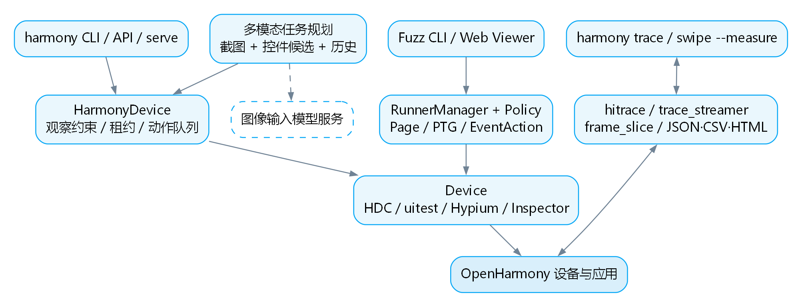
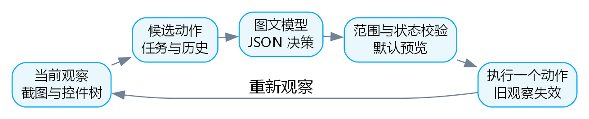

# HapTest：面向 OpenHarmony 应用的多模态智能测试与性能分析框架

北京航空航天大学 · SMAT · 刘发荣（独立作者）

版本：参赛提交版　日期：2026年11月7日

## 简介

### 背景

OpenHarmony 应用同时依赖 ArkUI 页面结构、Ability 生命周期和设备侧测试服务。单纯随机点击难以深入多层页面，固定坐标脚本又容易受分辨率、弹窗和页面变化影响。发现“能否到达页面”之后，开发者还需要判断交互过程是否产生长帧，并保留可追踪证据。

HapTest 围绕上述问题构建可扩展的动态分析框架。作品属于开源鸿蒙生态的测试框架与工具链创新，连接主机侧策略、系统测试服务和应用运行现场。技术工作集中于框架层、设备适配层与性能证据链。

### 目的

作品面向 OpenHarmony 应用开发者、测试人员与高校研究者，提供页面探索、截图与控件树联合规划、受约束的动作执行，以及基于系统 trace 的逐帧耗时分析。源码、命令入口、单元测试和材料在同一仓库内交付。

验收目标包括：能够扩展探索策略；能够从一份当前观察生成合法动作并逐步执行；能够从 frame_slice 数据生成逐帧 JSON、CSV 和 HTML 报告；能够明确区分已执行动作、模型完成判断、系统卡顿标记与耗时超预算统计。

## 设计描述

系统采用按职责拆分的框架结构。现有 Fuzz 路径承担页面迁移图探索；HarmonyDevice 路径承担可复用设备会话和多模态任务执行；性能分析路径承担 trace 采集与离线帧分析。各路径共享部分设备基础设施，但保留独立入口与明确约束。

### 总体设计

已实现的核心能力包括：HDC 设备枚举与诊断；uitest/Hypium RPC 设备通信；页面与控件建模；PTG 页面迁移图及 DFS、BFS、随机、回放等策略；静态引导策略接入；UI Viewer 与屏幕查看；带观察约束的 HarmonyDevice API、CLI 和 JSON-lines 会话。

本次补充实现两项能力。第一，多模态任务规划以当前截图、控件候选、任务和历史作为输入，解析模型 JSON 决策，绑定当前 observationId 执行动作并重新观察。第二，逐帧分析通过 hitrace 采集系统轨迹，调用用户指定的 trace_streamer 转换 SQLite，再读取 frame_slice，输出筛选后的耗时统计及逐帧证据。

创新点在于把探索模型、动作前置条件和性能证据放在同一套可复用工具中。系统不修改 OpenHarmony 内核或驱动，框架价值体现在对系统测试能力的组织、约束及扩展。

### 实现思路

页面探索将运行时页面表示为 Page，将 UI 事件表示为迁移边，通过 PTG 记录已访问页面和可达路径。Policy 选择动作，RunnerManager 负责调度，EventAction 保存迁移记录。静态引导利用独立静态分析模块的结果辅助探索。原有 --llm 是界面停滞时触发的文本引导路径。

新的 harmony plan 为独立的多模态入口。规划器根据可见、启用、具有有效边界的控件生成点击候选，并根据物理屏幕尺寸生成滑动候选。模型只能选择当前候选 ID；返回值必须满足 JSON 字段类型和候选范围检查。默认输出预览，指定 --execute 后执行，每一步重新获取截图和树。

性能模块保留原有 PerfReport 对 instructions、cycles 等采样数据的解析，新增逐帧 trace 路径。refreshRate 决定帧预算，durationMs=dur/1,000,000，budgetMs=1000/refreshRate。耗时超预算与系统 flag 映射分开统计，flag 的版本语义由用户显式提供。

### 系统结构

#### 模块划分

入口层包括 CLI、TypeScript API、JSON-lines 会话及 Web Viewer。框架层包括 Page/Component/PTG、Policy/RunnerManager、HarmonyDevice、MultimodalPlanner。设备层包括 HDC、uitest agent、Hypium RPC 与 ArkUI Inspector。分析层包括 PerfReport、TraceCapture 和 FrameReport。

图 1  框架模块与两条执行路径。虚线连接表示可选外部服务。

#### 系统架构说明

Fuzz 路径：CLI 创建 Fuzz，构建 Device 和 Hap，RunnerManager 读取 Page 并调用 Policy，EventAction 向设备发送事件，再采集目标页面形成迁移。该路径沿用既有 Device 执行机制，尚未整体迁移到 HarmonyDevice。

多模态路径：CLI 连接 HarmonyDevice，observe 获取截图和树，规划器构造候选动作，模型返回候选 ID，解析与校验后经 HarmonyDevice 执行。点击和滑动检查 observationId、界面内容、前台应用和屏幕尺寸。执行改变设备状态后，旧观察失效；动作结果不确定时停止，不自动重放。

逐帧路径：harmony trace 或 swipe --measure 启动 hitrace，结束采集并拉取唯一命名的 .htrace；可选调用本地 trace_streamer；perf analyze 从 SQLite 读取帧表并按进程、帧类型、时间范围筛选。HTML 仅展示前 10,000 帧，JSON/CSV 保留全部有效记录。

#### 文件结构

src/cli/：cli.ts 总入口、harmony_command.ts 设备命令、harmony_serve.ts 会话协议、perf_command.ts 帧分析命令。

src/device/：device.ts、hdc.ts、uidriver/ 设备协议；harmony/ 观察与动作会话、选择器、文件租约和错误码；perf/ 原有采样报告及新增 frame_report.ts、trace_capture.ts。

src/model/、src/event/、src/policy/、src/runner/：页面迁移模型、事件、探索策略和调度；multimodal_planner.ts 实现新的视觉任务规划。

res/ui-viewer/、res/screen-viewer/：本地页面资源；test/unit/：行为测试；test/e2e/：真机链路入口；doc/ 与 develop/：使用与研究说明；submission/：参赛简介、模板文档、答辩 PPT、演示及辅助材料。

### 模块功能描述

以下按设备与观察、多模态规划、逐帧性能分析三个子系统说明。各子系统具有独立接口，便于替换测试策略、模型服务或轨迹转换工具。

#### 设备会话与探索子系统功能描述

标识与类型：HarmonyDevice 为主机侧设备会话类；Page、Component、PTG 为模型类；Policy 为策略抽象类。目的：将系统测试服务抽象为可编程操作，并保存页面迁移信息。

HarmonyDevice 在连接时要求唯一在线设备或显式 serial，为同一 serial 建立跨进程文件租约，并在会话内串行执行动作。observe 返回时间、物理尺寸、前台 bundle、控件树及可选截图。识别到锁屏时不返回树和截图，截图前后还会复核锁屏状态。锁屏识别属于启发式能力。

选择器点击检查歧义并返回候选；坐标动作检查观察新鲜度。typeText 要求恰好一个聚焦的普通可编辑字段，并拒绝命中密码、验证码等敏感字段规则的输入。输入动作完成仅代表派发结果，业务正确性仍需要独立断言。

探索子系统通过 Policy.generateEvent(page) 扩展策略，支持页面图导航与路径记录。UI 停滞检测可触发原有文本 LLM 引导；新的多模态规划入口与该路径分别使用。

#### 多模态规划子系统功能描述

标识与类型：multimodal_planner.ts 为规划与执行模块，包含 planningCandidates、createVisionQuery、parsePlanDecision、runMultimodalTask。目的：根据视觉与结构信息解释用户任务，生成可验证、可约束的下一步操作。

输入包括任务文本、当前 PNG/JPEG 截图、由控件树生成的候选动作、bundle、物理尺寸和最近 12 步历史。候选控件描述保留类型、id、文本及 hint；每页最多保留 150 个点击候选，补充上下滑动和返回。截图限制 15 MiB，任务长度限制 4,000 字符，步数限制 1～50。

模型适配使用现有 OpenAI SDK 的 Chat Completions 兼容协议，模型由 HAPTEST_VISION_MODEL 或 --model 配置，支持 OPENAI_BASE_URL。请求包含 image_url 的 base64 图片和文本 JSON，要求 JSON 决策。模型调用超时 30 秒，不进行自动重试。配置凭证从环境变量读取。

返回协议为 {actionId, done, reason}。actionId 必须为当前候选整数 ID，done=true 时必须为 null。模型不得任意生成坐标，执行不包含模型生成文本输入。默认预览一条决策，--execute 开启闭环。点击和滑动经观察校验，返回键在执行前重新检查界面。plan.json 记录观察 ID、候选、理由和状态，不默认落盘截图。

模型完成判断标记为 model_completed，表示模型认为可见界面满足任务，不替代业务断言。模型出错、非法决策、过期观察或动作结果不确定都会停止。页面文字作为不可信数据放入请求，系统提示约束购买、删除、认证和外发消息等操作，但语义风险仍需测试任务范围控制。

图 2  多模态规划闭环。每一步重新观察，失败直接停止。

#### 逐帧性能分析子系统功能描述

标识与类型：trace_capture.ts 负责采集，frame_report.ts 负责 SQLite 读取、筛选、统计和导出，perf_command.ts 提供 CLI。目的：把交互阶段与系统帧切片关联，保留可检查的性能证据。

采集使用 hitrace --trace_begin graphic ability app，结束时 hitrace --trace_finish -o <唯一文件名>，通过 hdc 拉回文件。测量动作即使失败也会进入 finally 结束采集；只清理本次生成的远端 trace 文件，动作不自动重放。capture.json 记录采集与动作状态。

trace_streamer 由用户指定路径，随 DevEco/对应工具分发，不随本仓库复制。转换命令采用独立进程参数数组，输出 SQLite。读取通过 sql.js 的 WASM SQLite 引擎实现，避免要求系统安装 sqlite3。必须存在 id、ts、dur、ipid、type_desc、flag、frame_no 列，缺列报错。

报告支持 --ipid（trace 内部进程 ID）、--type（帧切片类型）、--start-ns/--end-ns（半开时间区间）。剔除负耗时、无效和超出安全整数范围的时间，保留 invalidFrameCount。P50/P95 使用 nearest-rank 算法。空帧结果标记 no_frames 并返回退出码 3。

overBudget 表示切片耗时严格大于所选刷新率预算；它不是 FPS，也不直接等同系统卡顿。系统 jankFlags 仅按显式 --jank-flags 映射，未映射返回 null。必须避免混合应用帧与 RenderService 帧造成重复计数。可变刷新率、异步渲染与不同系统版本需要额外校准。

图 3  trace 采集、离线转换和逐帧证据生成。

### 业务/实现流程说明

#### 用例1：多模态任务执行流程

前置条件：已解锁的测试设备可通过 hdc 访问，已配置图像输入模型与 API 凭证，应用处于可测试页面。调用 harmony doctor 检查环境，再运行 harmony plan --task "打开设置页面" --output out/plan 预览。

执行顺序：HarmonyDevice.connect 获取租约；observe({screenshot:true}) 读取现场；planningCandidates 从树中生成合法候选；createVisionQuery 发送截图、候选和任务；parsePlanDecision 检查响应；预览模式保存后退出，执行模式发送一个受约束动作后进入下一轮观察。

终止条件：模型判断完成、达到步数上限、调用超时、非法模型输出、界面变化或动作不确定。异常终止记录 stopped_on_error，执行控制交还用户，不重复动作。示例任务只用于演示，不声称覆盖任意业务流程。

#### 用例2：交互逐帧分析流程

前置条件：设备支持 hitrace 分类，主机准备兼容的 trace_streamer；已有 SQLite 时可直接离线分析。启动 harmony swipe --from 500,1600 --to 500,500 --measure --output out/perf，坐标须按当前设备实际尺寸选择。

先观察并绑定当前页面，然后开始 trace，执行一次滑动，保留约 1 秒动画尾部数据，结束 trace 并拉取。配置 --trace-streamer 或 HAPTEST_TRACE_STREAMER 后自动转换并分析；未配置则保留原始轨迹和后续转换指引。

通过 perf analyze 指定数据库、刷新率、进程与切片类型，生成 frames.json、frames.csv、frames.html。定位长帧时回看帧号、时间戳、flag 和原始轨迹。支持独立 harmony trace --seconds 5，期间在设备上人工触发交互。

### 接口描述

#### 调用接口

系统接口：HDC 提供设备枚举、shell 和文件收发；uitest/Hypium RPC 提供 UI 树、截图与输入；ArkUI Inspector 用于补充控件元数据。设备服务和 agent 的适配依赖系统版本，doctor 用于检查基础条件。

模型接口：Chat Completions 兼容的 POST /chat/completions，文本和图片组成一次请求，响应为 JSON 决策。模型需要支持图像输入及 JSON object 模式，外部服务费用、延迟和准确率依服务而异。

性能接口：hitrace 输出系统轨迹；trace_streamer <trace.htrace> -e <out.db> 进行离线转换；sql.js 读取 frame_slice。工具版本和系统版本必须在真机实验中记录。

#### 提供接口

API：HarmonyDevice.connect、observe、find、tap、swipe、typeText、pressKey、launchApp、stopApp、close；runMultimodalTask(device,{task,query,maxSteps,execute,output})；readFrameDatabase(db,options)、writeFrameReport(report,output)、captureTrace(serial,output,action,options)。

CLI：node bin/haptest harmony doctor；node bin/haptest harmony plan --task "打开设置页面" --model <视觉模型> [--execute]；node bin/haptest harmony trace --seconds 5；node bin/haptest perf analyze --db trace.db --output out/frames --refresh-rate 60。

会话协议：harmony serve 接收每行一个 JSON 请求，支持 observe、find、tap、swipe、type_text、press_key、apps、launch_app、stop_app、close。成功返回 {id,ok,result}，失败返回 {id,ok,error}。畸形请求返回错误后继续处理后续行。新增规划与帧分析通过独立 CLI/API 提供。

退出码：设备 CLI 为 0 成功、1 执行失败、2 用法错误、3 环境或动作前置条件失败。perf analyze 为 0 有有效帧、2 参数或解析失败、3 无匹配有效帧。JSON 输出写 stdout，人类可读信息写 stderr。

### UI设计

UI Viewer 延用已有本地 Web 页面。顶部包含设备选择、Connect Device / Reconnect Device、连接状态和 Fetch Current Page；主体包含截图画布、控件树与 Selected Element Info。用户可以查看层级与控件元数据，并复制 XPath 片段。screen 入口提供屏幕查看能力。

多模态规划使用命令行和 plan.json 展示任务、动作理由及状态，默认预览便于核查下一步。逐帧 HTML 报告展示帧数量、预算、P95 和明细表，橙色行表示耗时超预算；CSV/JSON 支持进一步分析。HTML 对控件外文本转义，避免原始帧类型字符串作为页面标记执行。

## 其他

### 成员分工

参赛学校：北京航空航天大学。团队名称：SMAT。参赛作者：刘发荣（独立作者）。本次参赛的方案组织、功能补充、集成验证、文档与答辩由独立作者承担。

代码包含既有开源 HapTest 实现与依赖，保留原始版权声明及 Apache License 2.0。独立作者指本次参赛署名，不将既有开源代码或相关团队研究改署为个人独创。专利材料申请人为北京航空航天大学，申请状态以随附通知书为准。

### 困难与思考

主要工程难点包括：不同系统版本的 agent 协议与帧表语义变化；截图和控件树的时间一致性；页面异步更新导致的过期动作；跨进程设备争用；大模型输出的不可预测性；应用帧和合成帧混合统计。采用显式设备选择、文件租约、动作队列、观察绑定、候选范围校验和原始证据保留来控制这些问题。

2026年11月7日本地验证：npm run build 通过；npm test -- --run 为 23 个测试文件、68 项测试全部通过。新增测试覆盖真实 HTTP 本地传输的图文输入、非法动作拒绝、预览不执行、每步重新观察、异常不重放，以及真实 SQLite 读取、筛选、P95、标记映射、导出、空帧和缺列处理。

独立样本验证使用人工构造的 SQLite 数据，不代表真实应用性能。真机 E2E 因未设置 HAPTEST_E2E_SERIAL 而跳过。当前没有外部模型服务调用结果或真实 .htrace 复现实验，因此不报告任务成功率、真实卡顿率、加速倍数或稳定性百分比。

后续验收按固定设备与系统版本进行：记录 hdc、agent、trace_streamer 和模型版本；运行设置应用基础链路；采集已知流畅/卡顿交互并与 DevEco 帧视图对齐；按多次重复统计任务完成率、覆盖、每步延迟、P95、异常退出与恢复情况。

扩展方向包括任务断言、帧类型与 jank flag 版本映射、应用与 RenderService 帧关联、可变刷新率预算，以及对 Fuzz 路径逐步复用观察与动作约束。

### 参考

[1] 本仓库 src/、test/、doc/、develop/ 与 AGENTS.md。各能力及对应源码见 submission/05-辅助材料/能力与证据对照.md。

[2] 开源项目 HapTest，https://github.com/SMAT-Lab/HapTest。保留仓库 LICENSE 与源码版权说明。

[3] OpenHarmony 文档，https://docs.openharmony.cn/；DevEco Studio 与命令行工具，https://developer.huawei.com/consumer/cn/deveco-studio/。

[4] OpenAI Chat Completions API Reference，https://developers.openai.com/api/reference/resources/chat/subresources/completions/methods/create。图像输入与 JSON 输出接口，查阅日期：2026年11月7日。

[5] 《发明专利申请初步审查合格通知书》，申请号 202510375959.1，发文日期 2025年5月15日，申请人北京航空航天大学。该通知书属于申请阶段材料。

[6] 官方赛道一开发设计文档模板、答辩模板。本文保留模板封面、目录和章节结构，按功能扩充子章节。
